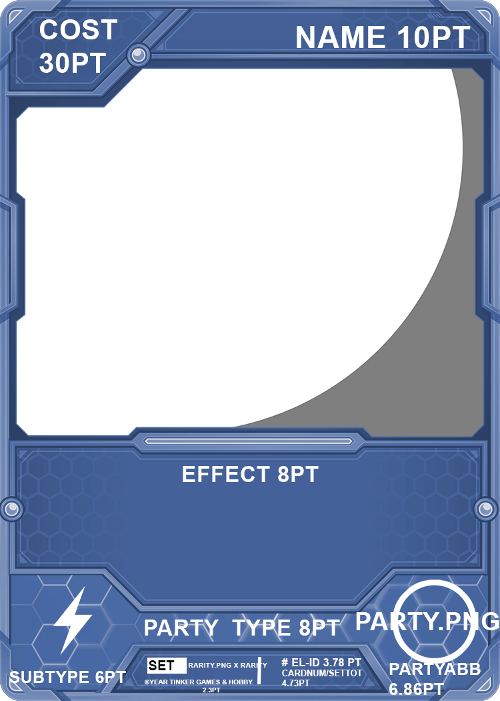

# Print-Ready Card Engine

Python pipeline that turns an Excel spreadsheet into **print-ready poker cards** (PNG + PDF) and optional **3×3 sticker sheets** — party templates, skill badges, portraits, and layout composition included.

Built for the **ELECTOR** tabletop card set: allies, candidates, and effect cards across multiple parties.

---

## Sample output

### Generated card (PNG · 2.5″ × 3.5″ @ 400 DPI)

<p align="center">
  
</p>

### Sticker sheet (US Letter · 9 slots)

<p align="center">
  
</p>

### Design templates (Ally · Candidate · Effect)

<p align="center">
  
  &nbsp;
  
  &nbsp;
  
</p>

---

## Features

- **Excel → cards** — reads `ELECTOR.xlsx` and composes each row onto the matching party × type background
- **Print specs** — poker cards at **1000 × 1400 px** (2.5″ × 3.5″ @ 400 DPI); sticker sheets on US Letter @ 300 DPI
- **Dual export** — individual **PNG** + letter-page **PDF** per card
- **Sticker packing** — automatic 3×3 sheets (PNG + PDF), 9 cards per page
- **Assets driven** — templates, party emblems, skill icons, and per-card avatars from folders
- **CLI filters** — generate all cards, one prototype, specific IDs, or a limit for fast iteration
- **Debug overlays** — optional layout boxes when tuning positions

---

## Quick start

```bash
python3 -m venv .venv
source .venv/bin/activate
pip install -r requirements.txt

python generate_cards.py                 # full run
python generate_cards.py --prototype     # Billy Snow only
python generate_cards.py --limit 10      # first 10 cards
```

**Requires:** Python 3.10+, Arial fonts in `fonts/` (bundled), and the `ELECTOR/` asset tree.

| Package     | Role              |
|-------------|-------------------|
| `openpyxl`  | Read Excel        |
| `Pillow`    | Compose card art  |
| `reportlab` | Write PDFs        |

---

## How it works

1. Load every data row from `ELECTOR.xlsx` (header skipped).
2. Pick a background from `ELECTOR/cardtemps/` using **PARTY** + **TYPE**.
3. Place a portrait from `ELECTOR/avatar/` (or `--avatar`).
4. Draw stats, name, subtype, effect text, emblem, skills, and footer.
5. Write `output/png/` and `output/pdfs/`.
6. Pack sticker sheets into `output/stickers/` (unless `--no-stickers`).

### Template mapping

| Party        | Prefix | Type      | Suffix | Example        |
|--------------|--------|-----------|--------|----------------|
| DEMOCRAT     | `dem`  | ALLY      | `ally` | `demally.png`  |
| REPUBLICAN   | `rep`  | CANDIDATE | `can`  | `repcan.png`   |
| GREEN        | `green`| EFFECT    | `eff`  | `greeneff.png` |
| LIBERTARIAN  | `lib`  | …         | …      | `libally.png`  |
| INDEPENDENT  | `ind`  | …         | …      | `indcan.png`   |
| UNIVERSAL    | `uni`  | …         | …      | `unieff.png`   |

Pattern: `{prefix}{suffix}.png` in `ELECTOR/cardtemps/`.

---

## CLI

```bash
python generate_cards.py [-h]
  --xlsx PATH          Excel workbook (default: ELECTOR.xlsx)
  --avatar PATH        Avatar folder or single image
  --out PATH           Output root (default: output)
  --ids [IDS ...]      Only these card IDs
  --limit N            Only first N matching cards
  --prototype          Billy Snow only
  --debug-layout       Overlay layout boxes on PNGs
  --no-stickers        Skip sticker sheet generation
```

**Examples**

```bash
python generate_cards.py --ids 0000001 0000151
python generate_cards.py --avatar path/to/portrait.png --limit 5
python generate_cards.py --prototype --debug-layout --no-stickers
```

---

## Project layout

```
.
├── generate_cards.py          # Main script
├── ELECTOR.xlsx               # Card data (source of truth)
├── requirements.txt
├── Sticker-temp.png           # Letter sticker sheet template
├── fonts/                     # Arial / Arial Bold
├── docs/samples/              # README preview images
├── ELECTOR/
│   ├── cardtemps/             # Party × type backgrounds
│   ├── iconslabels/           # Emblems + skill badges
│   └── avatar/                # Portraits ({CARDNUM}.png)
└── output/                    # Generated PNG / PDF / stickers
    ├── png/
    ├── pdfs/
    └── stickers/
```

---

## Excel → card fields

Columns are matched by **header name**. Common fields:

| Column | Use |
|--------|-----|
| `ID` / `NAME` / `PARTY` / `TYPE` | Identity + template |
| `SUBTYPE` / `EFFECT` / `COST` / `VC` / `MP` / `REGEN` | Stats & text |
| `SKILLS1` / `SKILLS2` | Skill badge icons |
| `CARDNUM` / `SETTOTAL` / `RARITY` / `SET` / `YEAR` | Footer & print run |
| `IMAGE` | Optional avatar stem |

---

## Adding cards

1. Edit rows in `ELECTOR.xlsx`.
2. Add templates under `ELECTOR/cardtemps/` for new party/type combos.
3. Drop skill PNGs into `ELECTOR/iconslabels/` (e.g. `SYNERGIZE.png`).
4. Optionally add `ELECTOR/avatar/{CARDNUM}.png`.
5. Re-run `python generate_cards.py` (or `--ids` / `--limit`).

---

## Notes

- Missing templates or icons cause that card to fail or skip the asset.
- Regenerating overwrites files with the same name under `output/`.
- For a longer client handoff guide, see [`README-client.md`](README-client.md).
